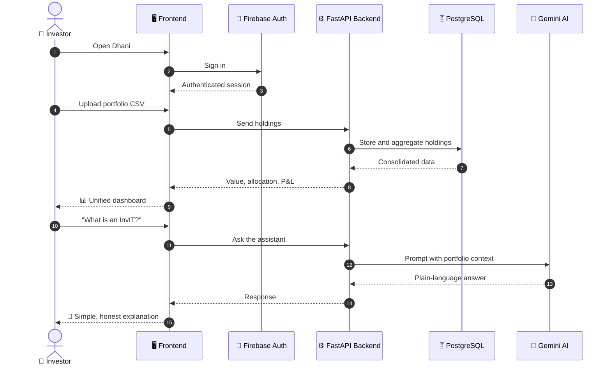
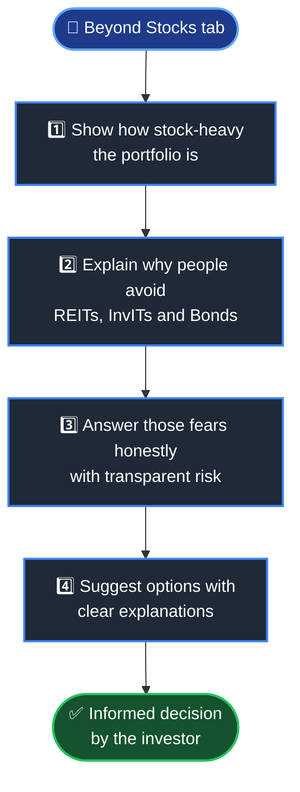
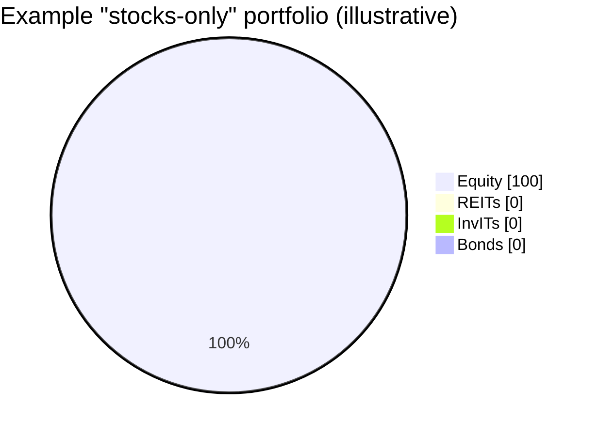
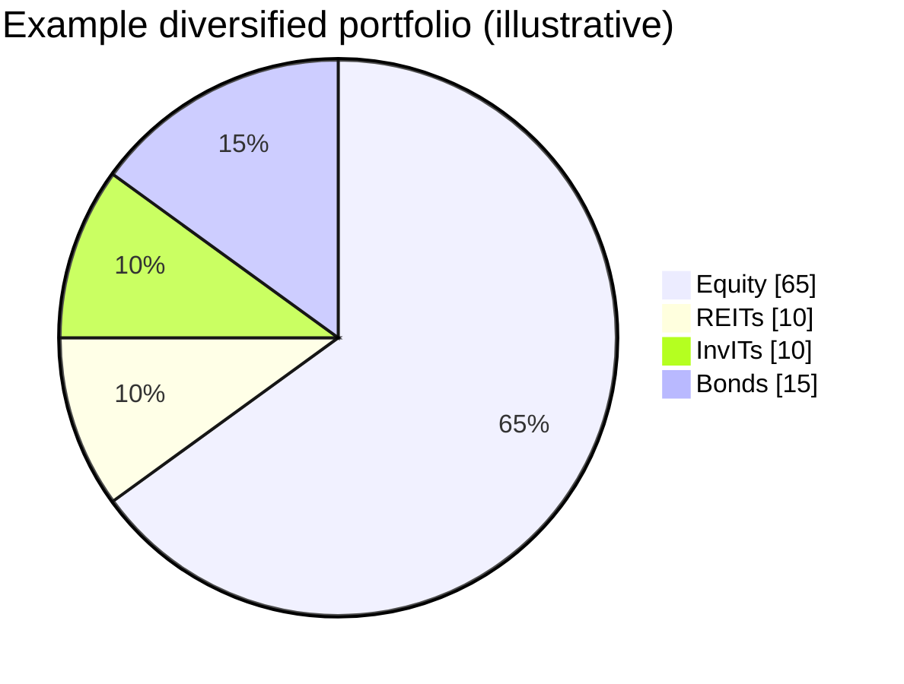
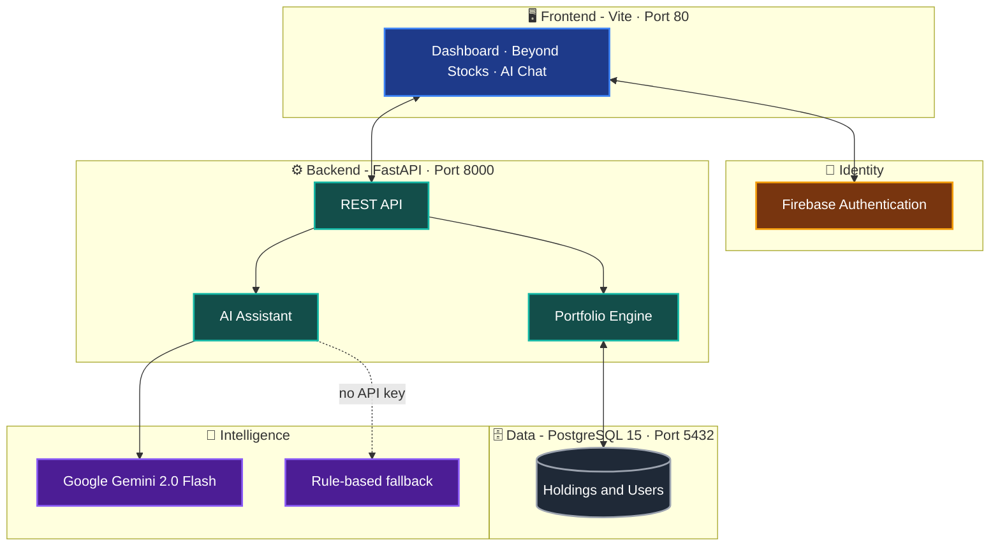
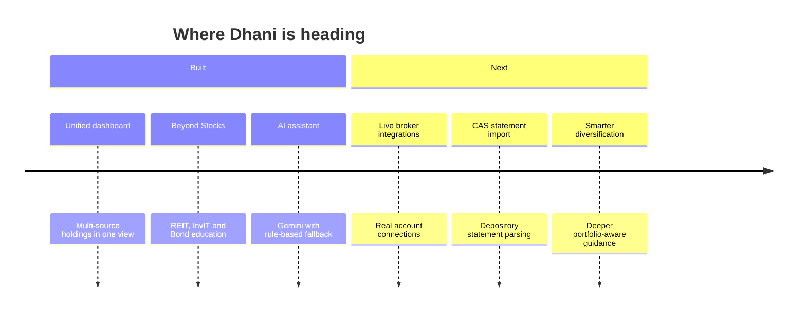

<div align="center">


<a href="https://readme-typing-svg.demolab.com">
  
</a>

<br/><br/>

<a href="https://drive.google.com/drive/folders/15b35T0Iab4B-sHwG1jD_HD1FpjaszdtO?usp=sharing">
  
</a>

<br/><br/>


<br/>

<a href="#-the-problem">🎯 Problem</a> •
<a href="#-the-solution">💡 Solution</a> •
<a href="#-features">✨ Features</a> •
<a href="#-how-it-works">🔄 How It Works</a> •
<a href="#-beyond-stocks">🧭 Beyond Stocks</a> •
<a href="#-architecture">🏗️ Architecture</a> •
<a href="#-quick-start">🚀 Quick Start</a>

</div>

<br/>

---

## 🎯 The Problem

> **Most retail investors in India hold only stocks.**
> Their holdings are scattered across brokers and depositories, and safer or income-generating options like **REITs, InvITs and Bonds** exist, but they stay away because they don't understand them.

<table>
<tr>
<td width="33%" align="center">

### 🗂️
**Scattered Holdings**

Stocks sit across multiple brokers and depositories (CDSL / NSDL). There is no single true picture of net worth.

</td>
<td width="33%" align="center">

### 🎢
**Stock Over-Concentration**

A portfolio that is 100% equity swings hard with the market, and most investors never notice the imbalance.

</td>
<td width="33%" align="center">

### 🤷
**Alternatives Feel Complex**

REITs, InvITs and bonds sound like jargon, so people skip them out of fear and confusion.

</td>
</tr>
</table>

---

## 💡 The Solution

**Dhani** is an **AI-powered investor super app** that does two things:

<table>
<tr>
<td width="50%" valign="top">

### 📊 1. Unified Portfolio Dashboard
Bring every holding into **one place**:
- 💰 Total portfolio value
- 🥧 Asset allocation
- 📈 Gains and losses
- 🏦 Holdings across multiple brokers and depositories

</td>
<td width="50%" valign="top">

### 🧭 2. Beyond Stocks Discovery
Teach and guide investors beyond equity:
- 📚 Plain-language explainers on REITs, InvITs and Bonds
- ⚠️ Honest risk and return transparency
- 🎯 Concentration check on the user's own portfolio
- 🤖 AI assistant to answer questions

```mermaid
flowchart LR
    A["😕 Scattered holdings<br/>Multiple brokers"] --> B["📥 Dhani<br/>Import and consolidate"]
    B --> C["📊 One dashboard<br/>Value, allocation, P&L"]
    C --> D["🔍 Concentration<br/>check"]
    D --> E["🧭 Beyond Stocks<br/>REITs, InvITs, Bonds"]
    E --> F["😎 Confident,<br/>diversified investor"]

    classDef pain fill:#7f1d1d,stroke:#ef4444,color:#fff,stroke-width:2px
    classDef core fill:#1e3a8a,stroke:#3b82f6,color:#fff,stroke-width:2px
    classDef dash fill:#134e4a,stroke:#14b8a6,color:#fff,stroke-width:2px
    classDef check fill:#78350f,stroke:#f59e0b,color:#fff,stroke-width:2px
    classDef disc fill:#4c1d95,stroke:#8b5cf6,color:#fff,stroke-width:2px
    classDef win fill:#14532d,stroke:#22c55e,color:#fff,stroke-width:2px
    class A pain
    class B core
    class C dash
    class D check
    class E disc
    class F win
```

</td>
</tr>
</table>



---

## ✨ Features

| | Feature | What it does |
|:-:|---|---|
| 📊 | **Unified Portfolio View** | Shows everything an investor owns in a single dashboard |
| 🏦 | **Multi-Broker Aggregation** | Combines holdings coming from more than one broker |
| 🏛️ | **Multi-Depository Aggregation** | Brings together holdings kept with different depositories |
| 📂 | **CSV Portfolio Import** | Load holdings from a simple file (`Name, Type, Quantity, AvgPrice, CurrentPrice, Source`) |
| 🥧 | **Asset Allocation** | Breaks the portfolio down by asset type so imbalance is visible at a glance |
| 📈 | **Gain / Loss Tracking** | Compares average buy price with current price per holding |
| 🧭 | **Beyond Stocks Tab** | Explains REITs, InvITs and Bonds and shows how stock-heavy the user is |
| 🤖 | **AI Financial Assistant** | Chat powered by **Google Gemini 2.0 Flash**, with a local rule-based fallback when no API key is set |
| 🔐 | **Authentication** | Sign-in handled through **Firebase** |
| 🐳 | **One-Command Deploy** | Frontend, backend and database all run through Docker Compose |

---

## 🔄 How It Works



---

## 🧭 Beyond Stocks

The **Beyond Stocks** tab is the heart of Dhani's mission: removing the barrier that keeps investors away from non-equity options.



### 🧱 The asset classes, in simple words

| | Instrument | In one line | Typical role in a portfolio | Main risks to understand |
|:-:|---|---|---|---|
| 📈 | **Stocks** | Ownership in a company | Long-term growth | Prices can fall sharply |
| 🏢 | **REITs** | Own income-generating real estate (offices, malls) and pass rental income to unit holders | Regular income plus property exposure | Vacancy, interest rates, unit price swings |
| 🛣️ | **InvITs** | Own infrastructure (roads, power lines, towers) and distribute their cash flows | Regular income from infrastructure | Project and regulatory risk, unit price swings |
| 🏦 | **Bonds** | You lend money to a government or company and receive interest | Stability and fixed income | Credit risk, interest-rate risk |

> 💡 REITs and InvITs are listed on exchanges, so they can be bought and sold through the same demat account as stocks.

### 🥧 Example: why concentration matters





> ⚠️ These charts are **examples to explain the idea**, not recommendations.

---

## 🏗️ Architecture



### 🧰 Tech Stack

<div align="center">


</div>

| Layer | Technology |
|---|---|
| 🖥️ **Frontend** | Vite-based web app with Firebase Authentication, animated with Framer Motion |
| ⚙️ **Backend** | Python **FastAPI** |
| 🗄️ **Database** | **PostgreSQL 15** (Neon, Supabase, Railway or local), with SQLite fallback for local use |
| 🤖 **AI** | **Google Gemini 2.0 Flash**, with a local rule-based engine as fallback |
| 🐳 **DevOps** | **Docker Compose** with a Postgres health check |

---

## 📂 Project Structure

```text
Dhani/
├── 📁 backend/              ⚙️  FastAPI server
├── 📁 frontend/             🖥️  Web app
├── 📁 docs/                 📚  Documentation
├── 🐳 docker-compose.yml    🧩  Runs postgres + backend + frontend
├── 🔑 .env.example          🔧  Environment variable template
├── 📄 sample_portfolio.csv  📊  Portfolio import format
├── 📜 LICENSE               ⚖️  MIT
└── 📖 README.md             👋  You are here
```

---

## 📂 Portfolio CSV Format

Import holdings using this structure:

| Column | Meaning |
|---|---|
| `Name` | Name of the instrument |
| `Type` | Asset class (for example Stock, REIT, InvIT, Bond) |
| `Quantity` | Units held |
| `AvgPrice` | Average buy price |
| `CurrentPrice` | Latest price |
| `Source` | Broker or depository the holding comes from |

```csv
Name,Type,Quantity,AvgPrice,CurrentPrice,Source
```

---

## 🚀 Quick Start

### 📋 Prerequisites


### 🧪 Run it

```bash
# 1️⃣ Clone
git clone https://github.com/Karan20coder/Dhani.git
cd Dhani

# 2️⃣ Configure
cp .env.example .env
# open .env and add your Firebase keys (and optionally GEMINI_API_KEY)

# 3️⃣ Launch everything
docker compose up --build
```

| Service | URL |
|---|---|
| 🖥️ Frontend | http://localhost |
| ⚙️ Backend API | http://localhost:8000 |
| 🗄️ PostgreSQL | localhost:5432 |

### 🔧 Environment Variables

| Variable | Purpose |
|---|---|
| `VITE_FIREBASE_*` | Firebase web app configuration for the frontend |
| `VITE_API_URL` | Backend URL used by the frontend (default `http://localhost:8000`) |
| `DATABASE_URL` | PostgreSQL connection string (leave empty to use local SQLite) |
| `FRONTEND_URL` | Allowed frontend origin for CORS |
| `GEMINI_API_KEY` | Enables the Gemini-powered assistant (falls back to rule-based if missing) |

> 🔒 **Never commit your real `.env` file.**

---

## 🎬 Demo

<div align="center">

<a href="https://drive.google.com/drive/folders/15b35T0Iab4B-sHwG1jD_HD1FpjaszdtO?usp=sharing">
  
</a>

</div>

---

## 🗺️ Roadmap



---

## ⚠️ Disclaimer

Dhani is built for **education and portfolio awareness**. Nothing in this app is investment advice, a recommendation, or a solicitation to buy or sell any security. All allocations and examples shown are illustrative. Please consult a **SEBI-registered investment adviser** before making investment decisions.

---

## 📜 License

Released under the **MIT License**. See [`LICENSE`](LICENSE) for details.

<div align="center">

<br/>

**Built with 💙 to make every investor a confident investor.**

<br/>


</div>
